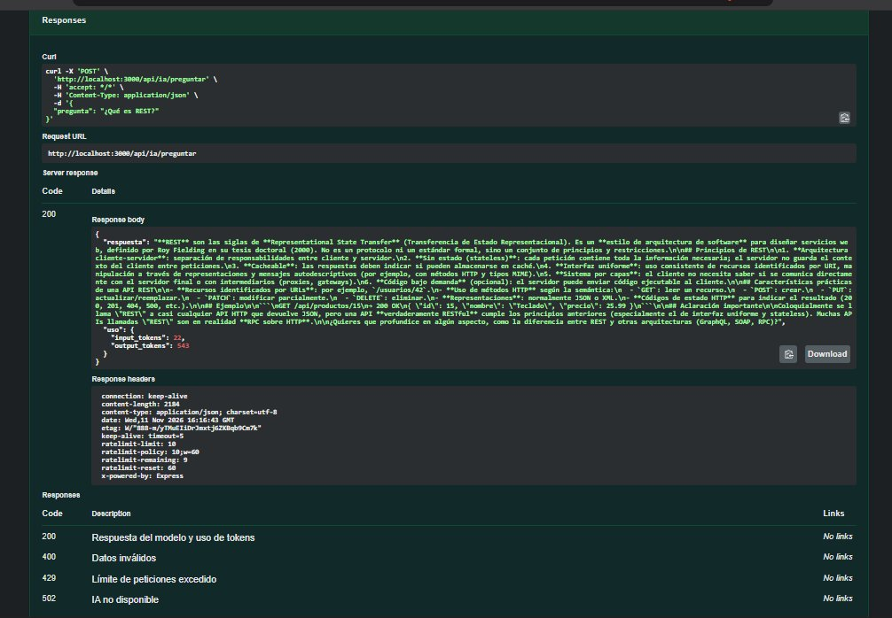
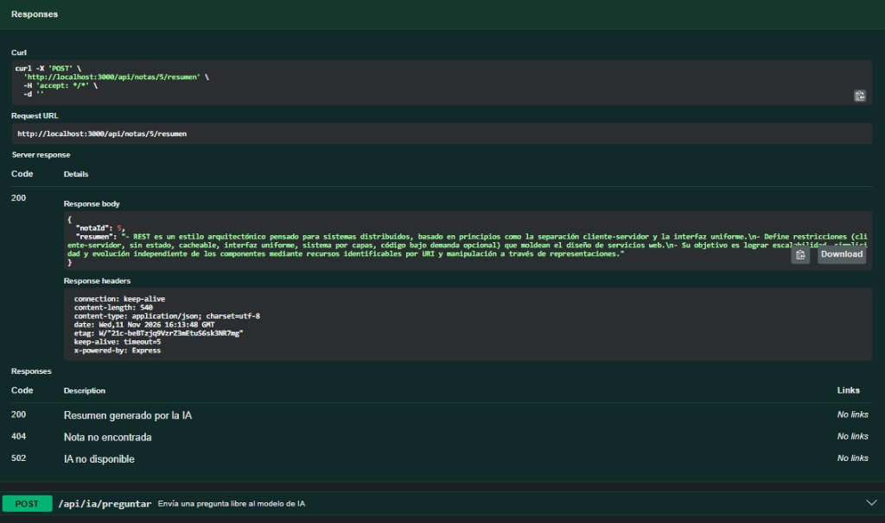
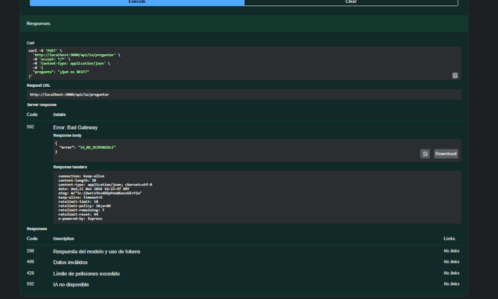

# Documentación Técnica de Endpoints (@openapi), Controladores y Servicios

## 1. Arquitectura en Capas (Routes → Controllers → Services)

```text
lab5-api/
├── src/
│   ├── config/
│   │   └── swagger.js                # Configuración OpenAPI 3.0 y componentes/esquemas
│   ├── routes/
│   │   ├── notas.routes.js           # 9 rutas de Notas + IA en Notas documentadas con @openapi
│   │   ├── ia.routes.js              # 6 rutas de IA y Chat documentadas con @openapi
│   │   └── agent.routes.js           # Ruta POST /api/agent del Agente IA con @openapi
│   ├── controllers/
│   │   ├── notas.controller.js       # Controlador CRUD de notas, resumen, traducción y palabras clave
│   │   ├── ia.controller.js          # Controlador de preguntas, chat multi-turno, streaming y uso
│   │   └── agent.controller.js       # Controlador del agente inteligente
│   ├── services/
│   │   ├── notas.service.js          # Acceso a datos con Prisma + SQLite
│   │   ├── llm.service.js            # Conexión con DeepSeek / Claude API y cálculo de costos
│   │   ├── claude.service.js         # Servicio compatible con la guía del Laboratorio 5
│   │   ├── agent.service.js          # Fábrica de agentes (soporte y analistaNotas)
│   │   └── tools/index.js            # Herramientas de consulta de notas para el agente
│   ├── middlewares/
│   │   ├── validar.js                # Validación de esquemas con Zod
│   │   ├── limitarIA.js              # Rate limit (10 req/min)
│   │   └── errorHandler.js           # Manejo centralizado de errores (AppError y APIError)
│   ├── app.js
│   └── index.js
```

---

## 2. Catálogo Completo de Endpoints Documentados con `@openapi` (17 operaciones)

### Bloque 1: Gestión de Notas (`tags: [Notas]`)
1. **`GET /api/notas`**: Lista todas las notas o filtra por query `?buscar=texto`.
2. **`GET /api/notas/{id}`**: Obtiene una nota específica por su ID (`200` o `404`).
3. **`POST /api/notas`**: Crea una nueva nota validando `titulo` y `contenido` con esquema `Nota` (`201` o `400`).
4. **`PUT /api/notas/{id}`**: Actualiza completamente el título y contenido de una nota (`200`, `400` o `404`).
5. **`PATCH /api/notas/{id}`**: Actualiza parcialmente solo el título o solo el contenido (`200`, `400` o `404`).
6. **`DELETE /api/notas/{id}`**: Elimina una nota por su ID (`204` o `404`).
7. **`GET /api-docs`**: Documentación interactiva Swagger UI.

### Bloque 2: Funciones de IA sobre Notas (`tags: [IA]`)
8. **`POST /api/notas/{id}/resumen`**: Resume el contenido de una nota en 3 viñetas (`200`, `404`, `502`).
9. **`POST /api/notas/{id}/palabras-clave`**: Extrae las 5 palabras clave principales de una nota con IA (`200`, `404`, `502`).
10. **`POST /api/notas/{id}/traducir`**: Traduce el título y contenido de una nota al idioma indicado (`200`, `400`, `404`, `502`).

### Bloque 3: Consultas Libres, Chat y Streaming IA (`tags: [IA]`)
11. **`POST /api/ia/preguntar`**: Envía una pregunta libre al modelo de IA (`200`, `400`, `429`, `502`).
12. **`POST /api/ia/chat`**: Conversación multi-turno con memoria en el servidor por `sesionId` (`200`, `400`, `502`).
13. **`DELETE /api/ia/chat/{sesionId}`**: Borra el historial de conversación de una sesión (`204`).
14. **`POST /api/ia/stream`**: Envía una pregunta y transmite la respuesta token por token mediante SSE (`200`, `400`, `502`).
15. **`GET /api/ia/uso`**: Devuelve el conteo de llamadas, `input_tokens`, `output_tokens` y `costo_estimado_usd` (`200`).

### Bloque 4: Agentes Inteligentes (`tags: [Agentes]`)
16. **`POST /api/ia/agente`**: Ejecuta el agente `soporte` o `analista` leyendo las notas guardadas en la base de datos (`200`, `400`, `502`).
17. **`POST /api/agent`**: Endpoint directo del agente según la arquitectura de `agentes-node` (`200`, `400`, `502`).

---

## 3. Capturas de Pruebas en Swagger UI

- 
- 
- 
